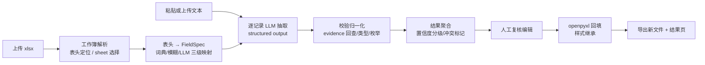

# 文本抽取 + 自动填表 Agent —— 可落地实现方案

## 0. 结论：推荐的最小可行方案

| 决策点 | 结论 | 理由 |
| --- | --- | --- |
| 产品形态 | **本地 Web 应用**（FastAPI + 单页前端），处理管线独立成 `pipeline` 包，另留 `cli.py` 入口 | 上传、表头预览、映射编辑、复核必须交互；但管线要可单测、可批处理，不能绑死 UI |
| 语言/框架 | Python 3.11 + FastAPI + Jinja2/HTMX（MVP 用原生 HTML+JS 也行），SQLite 存任务与模板 | 依赖少、部署简单、前后端不用双栈 |
| 表头驱动 | 列名 → `FieldSpec` → 动态 JSON Schema；**所有列（含未知列）都进 schema** | 新增列无需改代码，这是需求的核心约束 |
| 抽取主方案 | LLM 结构化输出（JSON Schema 严格模式），每个字段返回 `value / confidence / evidence` | 证据字段是后续校验与复核的基础 |
| 辅助方案 | 同义词词典 + 模糊匹配做映射；正则/dateutil 做归一化；evidence 回查原文做幻觉检测 | 规则用于确定性环节，LLM 只负责语义理解 |
| 表格读写 | **openpyxl 读写**，pandas 只用于内存预览/统计 | pandas 写回会丢样式、合并单元格、公式、列宽 |
| 输出策略 | 永远另存新文件，不覆盖原文件；默认追加行 | 用户表格是资产，破坏成本极高 |
| 隐私 | 默认云端 API 但必须显式告知；提供本地模型开关（Ollama / vLLM） | 简历、聊天记录属于敏感数据 |

一句话管线：

```
解析表头 → 生成 FieldSpec / JSON Schema → 文本切分记录
        → 逐记录 LLM 抽取（带证据）→ 校验归一化 → 低置信度标注
        → openpyxl 回填 → 导出新文件
```

MVP 范围：**单文件、单 sheet、单段文本、单条记录、同步抽取、导出**。多人/多记录、复核界面、模板记忆放 P1。

---

## 1. 整体架构



### 1.1 模块划分与目录

```
e:\tiqu\
├─ app/                     # Web 层（FastAPI）
│  ├─ main.py               # 路由：upload / mapping / extract / review / export
│  ├─ templates/            # 四步向导页面
│  └─ static/
├─ pipeline/                # 核心管线（不依赖 Web）
│  ├─ workbook.py           # openpyxl 封装：定位表头、读 sheet、回填
│  ├─ schema.py             # FieldSpec、JSON Schema 生成
│  ├─ fieldmap.py           # 列名 → 字段 的三级映射 + 模板记忆
│  ├─ segment.py            # 文本切分（单记录 / 多人）
│  ├─ extract.py            # LLM 调用、重试、并发、缓存
│  ├─ normalize.py          # 年龄/性别/日期/列表 归一化
│  ├─ validate.py           # 三态判定、置信度计算、冲突检测
│  └─ models.py             # 数据模型（pydantic）
├─ cli.py                   # python cli.py --xlsx a.xlsx --text b.txt
├─ storage/                 # SQLite：job、模板记忆、审计（不含原文）
└─ tests/fixtures/          # 真实表头 + 文本 + 期望结果
```

### 1.2 核心数据模型

```python
class FieldSpec(BaseModel):
    column_index: int          # 原表列序号(0-based)，回填锚点，不可变
    header: str                # 原表头原文，用于展示与写回
    key: str                   # 规范化字段 key（英文），用于 LLM 输出
    type: Literal["string", "integer", "number", "date", "enum", "list"] = "string"
    required: bool = False
    description: str = ""      # 给 LLM 的语义说明
    enum_values: list[str] | None = None
    normalizers: list[str] = []      # ["age","gender_cn","date_iso","phone"]
    mapping_confidence: float = 1.0
    origin: Literal["dict", "fuzzy", "llm", "custom", "user"] = "custom"

class CellResult(BaseModel):
    value: Any = None
    confidence: float = 0.0
    evidence: str | None = None
    status: Literal["ok", "uncertain", "not_mentioned", "conflict", "invalid"] = "ok"

class RecordResult(BaseModel):
    record_id: str
    name_hint: str | None = None
    source_span: tuple[int, int] | None = None
    cells: dict[str, CellResult]   # key -> CellResult
```

`column_index` 与表头文本绑定，`key` 只服务抽取，二者解耦——这样列名可以自由改、自定义列可以自由加。

---

## 2. 表头如何驱动抽取

### 2.1 表头定位

扫描前 10 行，打分：非空单元格数最多、绝大多数为字符串、不含纯数字/日期、下一行数据行类型更"杂"。得分最高行默认作为表头，界面允许用户改行号。合并单元格的表头取合并区左上角的值，并提示"该列是合并表头"。

### 2.2 三级字段映射

| 级别 | 手段 | 命中条件 | 备注 |
| --- | --- | --- | --- |
| L1 词典 | 内置同义词表 + 用户模板记忆（SQLite） | 归一化后完全相等（去空格/全半角/单位） | 如 姓名/名字/联系人 → `name` |
| L2 模糊 | rapidfuzz 相似度 + 字符 n-gram（可选本地 embedding） | 阈值 ≥ 0.85 | 800 列以内纯 CPU 毫秒级 |
| L3 LLM 兜底 | 把整组列名一次性给模型，输出 `{key,type,enum,description}` | L1/L2 未命中或用户手动要求 | 同类列成组判断，准确率明显高于逐列 |

无论哪级命中，都能得到 `type / required / enum` 的初始猜测：

```python
# 类型推断优先级：列名语义 > 已有数据采样 > 默认 string
TYPE_HINTS = {
    "age": ("integer", ["age"], ["18", "35"]),
    "gender": ("enum", ["gender_cn"], ["男", "女", "其他"]),
    "birth_date": ("date", ["date_iso"], ["1993-04-12", "1993-04"]),
    "hobbies": ("list", ["split_cn"], ["徒步", "摄影"]),
}
```

### 2.3 未知列（用户新增列）的处理

这是必须项：用户新增"公司""出生日期""期望薪资"时不能要求改代码。做法：

1. 映射失败 → `origin="custom"`，`key` 由列名做稳定 slug（`公司 → company`，重名加序号）。
2. `description` 直接用列名原文 + 一句模板："从文本中抽取与【公司】相关的最直接信息。"
3. 类型推断：无把握时用 `string`，抽取结果仍可返回文本，由用户在前端改类型后重抽。
4. 不做"白名单校验"——只要在 schema 里就抽，LLM 对未见过的字段名同样可用。

**关键取舍**：不追求"每列都映射到规范字段"，追求"每列都有一份可执行的抽取定义"。规范映射只用于 A) 复用模板、B) 启用归一化器（年龄/日期/性别）。

### 2.4 Schema 生成（列名 → JSON Schema）

```python
def build_schema(specs: list[FieldSpec]) -> dict:
    props = {}
    for s in specs:
        if s.type == "date":
            base, desc = "string", f"{s.description}（ISO 8601，如 1993-04-12；只有年月用 1993-04）"
        elif s.type == "enum":
            base, desc = "string", f"{s.description}（必须从 {s.enum_values} 中选）"
        elif s.type == "list":
            base, desc = "array", f"{s.description}（多个值用数组，单值也用数组）"
        elif s.type == "integer":
            base, desc = "integer", s.description
        elif s.type == "number":
            base, desc = "number", s.description
        else:
            base, desc = "string", s.description

        val = {"type": [base, "null"], "description": desc}
        if s.type == "enum":
            val["enum"] = s.enum_values + [None]
        if s.type == "list":
            val["items"] = {"type": "string"}

        props[s.key] = {
            "type": "object",
            "properties": {
                "value": val,
                "confidence": {"type": "number"},
                "evidence": {"type": ["string", "null"]},
            },
            "required": ["value", "confidence", "evidence"],
            "additionalProperties": False,
        }

    return {
        "type": "object",
        "properties": props,
        "required": list(props.keys()),
        "additionalProperties": False,
    }
```

`additionalProperties: false` + 全字段 required 是 OpenAI 严格模式的硬要求；某些国产兼容接口不接受 `type: ["string","null"]`，此时退化为 `anyOf` 或改用 function calling（见 3.2 的兼容分支）。

---

## 3. 抽取方案

### 3.1 记录切分（一条文本几条记录？）

| 场景 | 策略 |
| --- | --- |
| 单段简介 / 一份简历 | 直接单记录，不额外调 LLM，省一次调用 |
| 多段、带"姓名：""1. ""---" 等分隔 | 启发式切分（空行、编号、10 行窗口内出现高频人名） |
| 聊天记录 / 混杂文本 | LLM 切分：输出 `[{record_id, name_hint, quote(首句), start, end}]`；用 `quote` 回查偏移，quote 找不到就丢弃该段 |
| 同一人多段 | 按 `name_hint` 合并；无姓名时按字段重合度（≥2 个相同强字段）合并 |

界面上给三档：**自动 / 单记录 / 多人**，自动结果可见可改（拖选合并）。

### 3.2 抽取调用

```python
resp = client.chat.completions.create(
    model="deepseek-v3",              # 或 gpt-4o-mini / qwen-plus
    temperature=0,
    max_tokens=1024,
    response_format={
        "type": "json_schema",
        "json_schema": {"name": "extract", "strict": True, "schema": schema},
    },
    messages=[
        {"role": "system", "content": SYSTEM_PROMPT},
        {"role": "user", "content": f"<text>\n{record_text}\n</text>"},
    ],
)
```

提示词要点（按重要性排序）：

1. **只抽取不补全**：文本没写就返回 `null`，禁止用常识、禁止跨记录借用。宁可空，不可编。
2. **evidence 必须是原文连续片段**，逐字复制，不加书名号、不改标点；无对应原文则 `null`。
3. **值的形态约定**：日期 ISO；年龄只填数字；多值用数组；枚举只能取给定值（口语如"男""先生"可映射，但要在 evidence 里保留原话）。
4. **允许推导的范围写明**（如"生日 → 年龄"仅当列名是年龄且文本给出完整生日），其余一律不推导。
5. `confidence` 让模型自评 0–1，但**只在服务端作为一项输入**，不与规则分混用（模型自评普遍偏乐观）。
6. 1–2 个 few-shot 示例（一个全字段命中、一个大量 `null`），放在 system 里，比在 user 里更稳。
7. 长文本：按记录切分后单条送；单条超 4k token 时按段落切、字段级合并（merge 规则见 3.3）。不把 10 条记录塞一个请求——字段串味是主要错误来源。

兼容分支：provider 不支持 json_schema 时降级为 function calling；再不行退化为"prompt 要求纯 JSON + `json_repair` 修复 + pydantic 校验"，失败重试 1 次（带上次错误信息）。

### 3.3 多记录合并

同一人多次出现时，按字段合并：取值不同 → `status="conflict"` 保留候选；一有一无 → 取有值的；两者都低置信 → 保持低置信并进入复核队列。合并后 `evidence` 记录来源段编号，前端可跳回原文。

---

## 4. 准确性保障

### 4.1 三态 + 证据回查（最有效的一层）

```python
def check_evidence(ev: str | None, text: str) -> str:
    if not ev:
        return "not_mentioned"
    norm = lambda s: re.sub(r"[\s，。,、；:：\"'“”‘’]", "", s)
    return "ok" if norm(ev) in norm(text) else "hallucination_risk"
```

- `not_mentioned`：值为空且证据为空 → 空单元格，不写"未提及"字样（污染数据）。
- `hallucination_risk`：有值但证据回查失败 → 该值降级为"待复核"，默认不落盘（可由用户选择"仍要导出但标黄"）。

这一条比任何自评置信度都可靠，**必须实现**。

### 4.2 置信度公式

```python
score = 0.5 * llm_conf + 0.3 * (1 if evidence_ok else 0) + 0.2 * (1 if normalized_ok else 0)
```

阈值：`≥0.75` 绿（直接写入）；`0.5–0.75` 黄（写入并标注）；`<0.5` 或 `hallucination_risk` 红（默认留空，复核后再填）。阈值可配置，前端展示三色。

### 4.3 归一化规则

| 字段 | 规则 | 失败处理 |
| --- | --- | --- |
| 年龄 | 提取 0–120 整数；"32岁/32 周岁/90后"→数字；有完整生日可推算 | 超范围 → `invalid`，保留原值供复核 |
| 性别 | 男/女/其他；先生→男、女士→女（低置信） | 无法判定 → 原文保留 + 黄 |
| 日期 | dateutil + 中文"2020年3月/20.03.01"；输出 ISO；粒度（年月/日）记录在 metadata | 解析失败 → 原文 + 黄 |
| 列表 | 按 `、，,/ 和 及` 切分、去重、去空 | 保留原文 + 黄 |
| 姓名 | 去"姓名："前缀、去空格、全角转半角 | — |
| 数字 | 中文数字转阿拉伯；去"万/元"并记录单位 | — |

归一化函数都在 `normalize.py`，通过 `FieldSpec.normalizers` 挂载，自定义列默认为空——**不搞全局猜测**（例如"备注"里的数字不能被当年龄归一化）。

### 4.4 人工复核路径

MVP 也在结果页给最小复核能力：单元格颜色 + 悬浮显示证据 + 点击原文高亮 + 就地编辑。P1 加"只显示红色""按字段筛选""重抽单格"。复核动作写审计日志（字段、旧值、新值、操作人、时间）。

---

## 5. 表格读写

| 关注点 | 方案 |
| --- | --- |
| 选库 | `openpyxl` 读+写（保留样式/合并/列宽/公式/图片）；`pandas` 仅用于 read-only 预览与统计，不参与写回 |
| 加载 | `load_workbook(path, data_only=False)`；`.xlsm` 需 `keep_vba=True`；**写回时绝不 `data_only=True`**（会把公式写成缓存值） |
| 表头行 | 用户确认行号，默认自动打分（见 2.1）；合并表头取左上角 |
| 合并单元格 | 目标写入格若落在 `ws.merged_cells.ranges` 内 → 不写，记警告；表头合并列按左上角列号映射；不对合并区做拆解 |
| 多 sheet | 列出所有 sheet + 行数 + 前 3 行预览，用户选择目标 sheet；导出时其他 sheet 原样保留 |
| 追加 vs 覆盖 | 默认**追加**（`start_row = ws.max_row + 1`）；提供"从第 N 行开始覆盖"，覆盖前二次确认；空白占位行不计入 max_row |
| 样式 | 新行从表头/上一行 `copy(cell._style)`，日期列设 `number_format="yyyy-mm-dd"`，文本列设对齐方式 |
| 公式列 | 若目标列在数据区已有公式，提示"该列是公式列，是否跳过" |
| 数据验证/条件格式 | 不自动继承；提示用户（Excel 不会把 DV 复制到新行） |
| 文件安全 | 输出 `原名_filled_YYYYMMDD_HHMM.xlsx`，原文件只读；失败时删除半成品 |

```python
from copy import copy

ws = wb[sheet_name]
start_row = ws.max_row + 1
tpl_row = header_row + 1 if ws.max_row >= header_row + 1 else header_row

for r, rec in enumerate(records, start=start_row):
    for spec in specs:
        cell_res = rec.cells.get(spec.key)
        if cell_res is None or cell_res.status not in ("ok", "uncertain"):
            continue                                  # 空值/红标不写
        dst = ws.cell(row=r, column=spec.column_index + 1)
        src = ws.cell(row=tpl_row, column=spec.column_index + 1)
        dst._style = copy(src._style)                 # 继承行样式
        if spec.type == "date":
            dst.value, dst.number_format = parse_date(cell_res.value), "yyyy-mm-dd"
        elif spec.type == "list":
            dst.value = "、".join(cell_res.value or [])
        else:
            dst.value = cell_res.value

wb.save(out_path)   # 另存，不覆盖
```

坑位清单：`.xls` 老格式 openpyxl 不支持（提示用户先另存为 xlsx）；加密文件直接拒绝；超大文件（>20MB 或 >5 万行）走 write_only 模式并禁用预览缩略。

---

## 6. 交互与体验（四步向导）

| 步骤 | 内容 | 关键校验/提示 |
| --- | --- | --- |
| 1 上传 | 拖拽 xlsx/xlsm + 粘贴文本或上传 txt/docx | 扩展名、大小 ≤20MB、能否打开、是否加密、是否找到表头；失败给具体原因而非"上传失败" |
| 2 表头确认 | 表头行选择器、列勾选、每列 type/枚举/必填、映射来源色标（词典/模糊/LLM/自定义） | 重名表头自动加后缀；未识别列默认"自定义-字符串"并可手动改 |
| 3 抽取设置 | 单/多人模式、目标 sheet、追加/覆盖、阈值 | 覆盖模式二次确认；多人模式提示"每段将单独成行" |
| 4 结果预览 | 行=记录、列=表头、单元格三色、右侧证据面板、行内编辑、"重抽此格" | 显示"共 N 条记录 / M 个高置信 / K 个待复核"；导出前给出落盘数量摘要 |

错误分级：
- **阻断**：文件损坏、无表头、无可抽取列、模型鉴权失败 → 停在第 1/2 步，给修复动作。
- **可继续**：部分字段抽取失败、个别记录切分不明 → 黄色提示，允许带瑕疵导出。
- **提示**：evidence 未命中、类型被自动降级 → 悬浮说明。

失败重试：单记录失败自动重试 1 次（温度不变、附上错误），仍失败则该记录全字段标"抽取失败"，不阻塞整批。

---

## 7. 成本、性能与隐私

**调用成本**：按"每记录一次调用"设计。100 条记录 × (schema+prompt ≈ 600 tok 输入, 400 tok 输出) ≈ 10 万输入 token。用 gpt-4o-mini 级别模型量级在几分钱；用旗舰模型则需提醒用户。控制手段：
- 同 `(text_hash, schema_hash, model)` 结果缓存（SQLite），重复上传不重复计费；
- 并发 4–8（签名/限流用 `asyncio.Semaphore`），100 条同步请求约十几秒；
- 短文本单记录时跳过切分调用，省 1 次；
- 列很多时裁掉用户未勾选的列（schema 越小越便宜、越准）。

**隐私三档**（前端显式选择，默认"云端"但必须勾选同意）：

| 模式 | 行为 | 适用 |
| --- | --- | --- |
| 云端 | 原文发送给模型 API | 默认，需明示"文本会发送至第三方模型服务" |
| 脱敏后云端 | 正则替换手机号/身份证/邮箱为占位符，回调后再还原 | 折中 |
| 本地 | Ollama / vLLM + Qwen2.5-7B-Instruct（支持 JSON 输出） | 企业/敏感数据 |

配套：日志只存 `text_hash` 与统计，不落原文；导出文件不落盘长期（可配 TTL 清理）；不把原文写进错误上报。

**本地模型取舍**：7B 级在字段抽取上可用，但 evidence 逐字复制与 `null` 判定弱于闭源模型，需要更严的后校验。因此不建议作为 MVP 默认，作为开关即可。

---

## 8. 分阶段落地

| 阶段 | 范围 | 交付物 | 验收标准 |
| --- | --- | --- | --- |
| **P0 MVP** | 单 xlsx、单 sheet、单段文本、单记录、同步抽取、追加写入、导出 | `pipeline` 包 + 四步向导（可砍成 2 页）+ CLI + 10 组真实样本测试 | ① 字段准确率 ≥85%（人工对照 10 张真实表）；② **编造率 0**（未提及字段必须为空）；③ 导出文件样式/列宽/合并单元格/其他 sheet 与原文件一致；④ 单表单文本端到端 <30s；⑤ 原文件不被修改 |
| **P1 复核与多记录** | 记录切分（自动/单/多人）、多人合并、三色标注、证据高亮、行内编辑重抽、模板记忆、批量 txt | 复核页 + SQLite 模板表 + 批量接口 | ① 10 段混杂文本切分准确率 ≥90%；② 红色项可逐条复核并导出；③ 同表头二次上传映射命中率 100%（走模板） |
| **P2 规模化** | 多文件/多 sheet、异步 job + 进度、本地模型开关、审计日志、权限 | 任务队列 + 设置页 + 审计表 | ① 1000 条记录任务可中断/续跑；② 本地模式全链路可跑通；③ 每次导出可追溯 |

P0 只做"能跑通 + 不破坏表格 + 不编造"三件事，映射可视化、复核、模板都靠后——先验证 LLM 抽取在真实表上的准确率，再决定是否投入 UI。

---

## 9. 主要风险与边界

| 风险 | 表现 | 缓解 |
| --- | --- | --- |
| 列名语义不明 | "备注""信息""其他"无从判断 | 映射给低置信 + 要求用户补一句字段说明；不强行猜测 |
| 文本信息冲突 | 同一人两段年龄不同 | 保留候选、标 conflict，交人工裁决；不自动取其一 |
| 模型编造 | 空字段被"合理"填充 | evidence 回查 + 允许 null 的 schema + 提示词硬约束 + 编造率纳入验收 |
| 表格格式破坏 | 样式丢失、合并被拆、公式变值 | 只用 openpyxl、另存新文件、写前检查合并区与公式列、端到端 diff 校验 |
| 列名重名 | 两个"电话"列 | 加后缀生成唯一 key，回填仍按 `column_index`，不受影响 |
| 超长/超大 | 文本超上下文、表格写不动 | 按记录切分；行数 >5 万走 write_only；超出则拒绝并给替代方案 |
| 编码/乱码 | GBK txt、全角标点 | 上传时多编码探测（utf-8/gbk），统一全半角后比对 evidence 时保留原始字符 |
| 隐私合规 | 简历外发 | 三档模式 + 显式同意 + 不存原文，企业场景默认本地 |
| 责任边界 | 用户直接使用导出结果 | 结果页明确标注"AI 抽取，请复核"，未复核项带标记 |

**明确不做**：不做跨文档知识补全（如根据公司名猜行业）、不做图片/扫描件 OCR（P3 再说）、不做自动改写文本、不覆盖原文件。

---

## 10. 下一步编码顺序

1. `pipeline/workbook.py`：只读表头 + 追加写入两个函数，先用真实样本验证"格式不破坏"。
2. `pipeline/models.py` + `schema.py`：FieldSpec 与 JSON Schema，写单测。
3. `pipeline/fieldmap.py`：词典 + rapidfuzz，先支持 20 个常见字段。
4. `pipeline/extract.py`：单记录抽取 + evidence 校验，跑 10 组样本算准确率。
5. `cli.py` 端到端跑通（xlsx + txt → 新 xlsx），这是 MVP 的技术验证点。
6. FastAPI 四步向导（可先两页），再做复核与模板。
